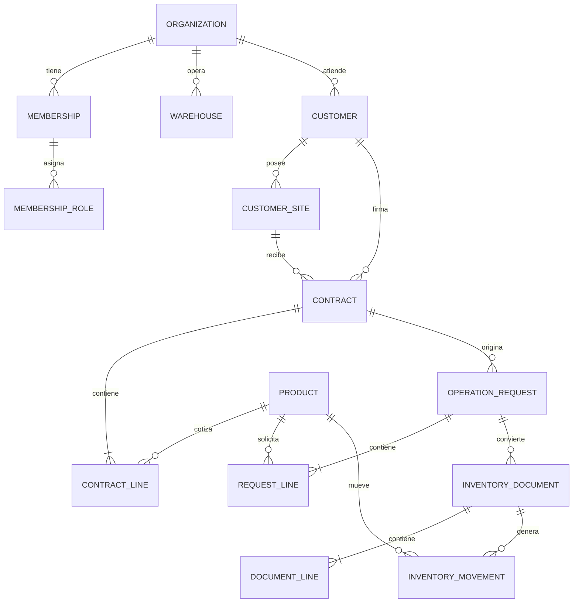

# Modelo de dominios

## Contratos y renovaciones

- `contract_type` distingue renta y venta; nunca se deduce del estado.
- Una renovación es un contrato nuevo con `previous_contract_id` y el mismo `contract_chain_id`.
- Renovar no genera movimientos ni cambia la custodia física.
- El contrato anterior puede cerrarse administrativamente sólo sin reservas pendientes; la cadena conserva el saldo físico hasta que una HE lo modifique.
- Renta permite SS, HS, SE y HE. Venta permite SS y HS; devoluciones de venta quedan fuera del MVP.

## Inventario

- Las ubicaciones físicas y virtuales comparten una entidad: almacén disponible, inspección, mantenimiento, dañado, cliente/obra, vendido y baja.
- Una reserva está asociada a una línea de SS autorizada.
- Un movimiento registra origen, destino, producto, cantidad, documento y reversión opcional.
- Una HE puede dividir una devolución en varias líneas para clasificar cantidades distintas.
