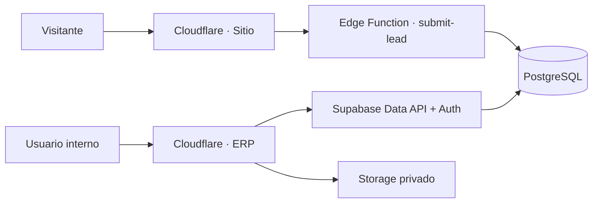

# Arquitectura de Andavalle

## Límites del sistema

Andavalle se entrega como un monorepo con dos aplicaciones web y una plataforma de datos:

- `apps/site`: contenido público y formulario de prospectos.
- `apps/erp`: aplicación autenticada para comercial, almacén, logística y administración.
- `packages/shared`: tipos, etiquetas, validaciones y fábrica del cliente Supabase.
- `supabase`: migraciones, datos ficticios y funciones de servidor.

## Principios

1. PostgreSQL es la autoridad de permisos, folios, reservas y movimientos.
2. El navegador usa exclusivamente la clave publicable; RLS y grants protegen cada tabla.
3. Las confirmaciones se realizan mediante funciones transaccionales e idempotentes.
4. Los documentos confirmados no se editan; una corrección crea una reversión trazable.
5. El saldo se deriva del ledger. Las reservas reducen disponibilidad sin cambiar existencia física.
6. Toda entidad de negocio pertenece a una organización, aunque inicialmente sólo exista Andavalle.

## Entornos y despliegue

- Desarrollo usa datos ficticios mediante `VITE_DEMO_MODE=true`.
- Cloudflare compila cada app desde su propio directorio y recibe sólo variables `VITE_*` públicas.
- Supabase guarda `TURNSTILE_SECRET_KEY`, claves secretas y orígenes permitidos fuera del repositorio.
- El formulario público exige Turnstile y consentimiento del aviso de privacidad; la Edge Function registra fecha y versión aceptada, no el token de Turnstile.
- La migración se prueba en el proyecto de desarrollo antes de crear el corte físico de producción.

## Documentos de diseño vigentes

- `target-data-model.md`: modelo conceptual validado de OR, contratos e inventario.
- `logical-schema-v2.md`: propuesta de tablas, claves, restricciones, vistas e índices; todavía no es SQL ejecutable.
- `schema-gap-analysis.md`: diferencias entre las migraciones actuales y el esquema objetivo, con estrategia de transición.
- `product-catalog-design.md`: propuesta de código de catálogo, SKU legible, familias, medidas y referencias externas.
- `permissions.md`: matriz de capacidades por rol.
- `state-machines.md`: estados y transiciones permitidas.
- `inventory-and-audit.md`: reglas del ledger, disponibilidad y auditoría.
