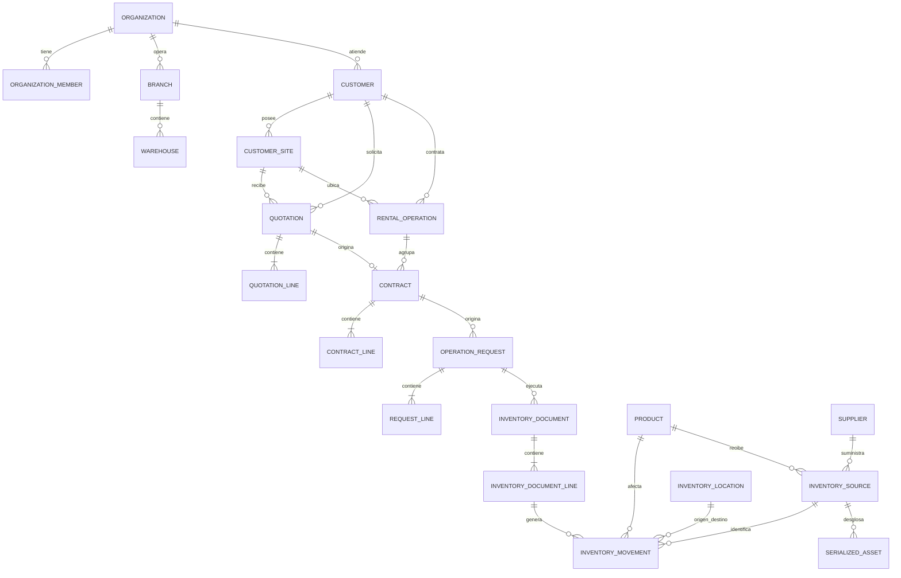

# Modelo de datos objetivo — ERP Andavalle

**Estado:** propuesta conceptual para validación
**Fecha:** 2026-10-22
**Alcance:** planeación; este documento no modifica Supabase ni las migraciones existentes

## 1. Principios

- Todas las entidades operativas pertenecen a una `organization_id`.
- La Operación de Renta (`rental_operations`) sustituirá conceptualmente a `contract_chains`.
- Una OR pertenece a un solo cliente y una sola obra, pero una obra puede tener varias OR activas.
- Venta no utiliza OR.
- Los documentos confirmados son inmutables y se corrigen con documentos compensatorios.
- El ledger de movimientos es la fuente de verdad del inventario.
- Las reservas apartan disponibilidad, pero no representan movimiento físico.
- La propiedad, procedencia, ubicación y condición del equipo se conservan por separado.
- Los estados derivados no se editarán libremente.

## 2. Vista global



## 3. Identidad y organización

### Entidades conservadas

- `organizations`
- `profiles`
- `organization_members`
- `organization_member_roles`
- `branches`
- `warehouses`

### Reglas

- Los roles acumulables serán `admin`, `commercial`, `warehouse` y `logistics`.
- Una membresía inactiva revoca el acceso aunque el usuario conserve una sesión válida.
- Las decisiones de autorización se basarán en membresías y roles protegidos, nunca en metadatos editables del usuario.

## 4. CRM y cotizaciones

### `customers`, `customer_contacts` y `customer_sites`

- Un cliente puede tener varios contactos y obras.
- Los clientes pueden ser persona física o moral; el RFC es opcional hasta preparar la primera cotización.
- Cliente usa `CLI-000001` y obra `OBR-000001`, ambos consecutivos permanentes por organización.
- No puede existir otro cliente activo con el mismo RFC normalizado.
- Sólo existe un contacto principal activo por cliente y un contacto puede asociarse opcionalmente a una obra.
- Una obra pertenece a un solo cliente.
- La dirección utilizada por una OR queda fijada mediante `customer_site_id`; un cambio de obra exige una OR nueva.

### `crm_leads` y `customer_activities`

- `crm_leads` representa oportunidades de prospectos nuevos o clientes existentes.
- Etapas: nueva, contactada, calificada, cotización, ganada y perdida.
- Cada oportunidad tiene un responsable principal y toda reasignación conserva historial.
- El origen y el motivo de pérdida provienen de catálogos controlados; `otro` exige explicación.
- Los datos mínimos son nombre o empresa, teléfono o correo, necesidad y origen.
- Las coincidencias por teléfono, correo o RFC generan advertencia; continuar requiere motivo.
- Actividades: llamada, correo, WhatsApp, visita, tarea y nota.
- Después de contactar debe existir un siguiente seguimiento o cerrarse la oportunidad.
- La conversión ocurre al preparar la primera cotización y reutiliza un cliente existente cuando corresponda.
- Una oportunidad puede tener varias cotizaciones y se gana al aceptar una.
- Toda cotización pertenece a una oportunidad; si se inicia sin ella, se crea una automáticamente.
- Los prospectos web llegan sin asignar a una bandeja compartida y generan seguimiento a 24 horas.
- Una oportunidad perdida no se reabre; un nuevo interés crea otra oportunidad enlazada.
- Los registros del CRM se archivan o cierran y no se eliminan físicamente desde la aplicación.
- El formulario web conserva fecha y versión del aviso de privacidad aceptado.

### `quotations`

Campos conceptuales principales:

- oportunidad obligatoria;
- tipo: renta o venta;
- cliente, contacto y obra con dirección;
- estado;
- intención de OR: nueva o existente;
- `rental_operation_id` cuando continúa una OR;
- motivo: inicial, renovación, ampliación, cambio de condiciones, reposición u otro;
- explicación obligatoria cuando el motivo sea `otro`;
- vigencia general opcional;
- totales e impuestos como fotografía comercial.

### `quotation_lines`

- producto/SKU y cantidad;
- tarifa y periodo de cobro;
- descuento e impuestos;
- vigencia particular opcional;
- la vigencia particular prevalece sobre la general.

Una cotización aceptada genera exactamente un contrato nuevo. La cotización y sus líneas quedan como fotografía histórica y no se reutilizan como contrato editable.

## 5. Operación de Renta y contratos

### `rental_operations`

Representa el folio raíz `OR-AÑO-SECUENCIA`.

Campos principales:

- organización, cliente y obra;
- folio;
- nombre o descripción obligatoria;
- fechas de creación y cierre;
- motivo y evidencia de cierre excepcional;
- marca de cancelación.

Estado derivado:

```text
planeada → activa → pendiente_devolucion → cerrada
    └──────────────────────────────→ cancelada
```

- `planeada`: existe el primer contrato, pero todavía no hay entrega activa.
- `activa`: existen contratos o equipo físico vigente en obra.
- `pendiente_devolucion`: existe saldo físico sin cobertura después de la gracia, o se espera su retorno.
- `cerrada`: saldo físico cero y sin documentos pendientes, o cierre excepcional con saldo resuelto o transferido.
- `cancelada`: no produjo movimientos y fue anulada.

Una OR cerrada no se reabre.

### `contracts`

- tipo renta o venta;
- cotización de origen;
- OR obligatoria sólo para renta;
- contrato anterior para renovaciones;
- propósito: inicial, renovación, ampliación, cambio, reposición u otro;
- estado y autorización;
- condiciones e importes congelados.

Los contratos pueden traslaparse dentro de una OR cuando sean ampliaciones, cantidades adicionales o SKU distintos. Una renovación no puede duplicar accidentalmente la cobertura del mismo equipo y periodo.

### `contract_lines`

- producto, cantidad, tarifa y unidad de cobro;
- descuento, impuesto e importes;
- inicio y fin acordados por SKU;
- `previous_contract_line_id` para renovaciones parciales;
- regla de inicio y fin cobrable;
- días de gracia calculados.

Regla de gracia:

```text
si vigencia < 15 días: 0
si vigencia >= 15 días: min(5, max(2, ceil(vigencia * 10 %)))
```

La gracia permite formalizar la renovación, pero no constituye días gratuitos.

## 6. Solicitudes y logística

### `operation_requests`

Documento común con tipo `SS` o `SE`, relacionado con contrato y OR.

- Comercial crea la SS; almacén la autoriza.
- Comercial crea la SE; logística programa y almacén autoriza.
- Un administrador puede intervenir excepcionalmente con auditoría.
- Una ampliación puede proponer una SS en borrador por la diferencia.
- Una reducción puede proponer una SE en borrador por la diferencia.

### `request_lines`

Conservan producto, cantidad solicitada, cantidad surtida o recibida y vínculo opcional con la línea contractual que les dio origen.

### `logistics_assignments`

Registra fecha, vehículo, operador y estado logístico. Estos datos son obligatorios en HS/HE únicamente cuando existe transporte asociado.

## 7. Inventario y procedencia

### `products`

Cada producto define `tracking_mode`:

- `quantity`: control agregado para andamios, componentes y accesorios comunes;
- `serialized`: control individual para maquinaria, vehículos y equipo especial.

### `suppliers`

Catálogo mínimo de proveedores para compras y subarrendamientos. Guardará razón social o nombre, RFC cuando aplique, contacto, teléfono o correo y estado. Cada entrada conservará el tipo de documento soporte —contrato, factura, remisión u orden—, su referencia y el archivo adjunto. Esto no constituye todavía un módulo completo de compras.

### `inventory_sources`

Identifica de dónde proviene cada existencia o lote:

- propiedad: propia, subarrendada o de tercero;
- origen: compra, subarrendamiento, inventario inicial u otro autorizado;
- proveedor y referencia externa;
- vigencia y fecha prevista de devolución;
- costo o tarifa de referencia;
- documento y línea de entrada que originaron la existencia.

Una fuente subarrendada no podrá comprometerse más allá de su fecha de devolución sin ampliar previamente su vigencia.

Los costos de compra y subarrendamiento serán visibles para administración y comercial. Almacén verá únicamente proveedor, propiedad y vigencia necesarios para operar el inventario.

### `serialized_assets`

Sólo aplica a productos serializados. Cada unidad conserva organización, producto, fuente, número de serie, estado y ubicación actual verificable contra el ledger.

### `inventory_locations`

Representa ubicaciones físicas o virtuales:

- disponible;
- inspección;
- mantenimiento;
- dañada;
- cliente/obra;
- en tránsito;
- vendida;
- baja.

### `stock_reservations` y `reservation_allocations`

- La reserva nace al autorizar una SS.
- La cabecera conserva producto, ubicación y cantidad total.
- Las asignaciones dividen la reserva entre fuentes propias o subarrendadas y, cuando corresponda, activos serializados.
- Cancelar la SS libera sólo el remanente no consumido.

### `inventory_documents`

Tipos previstos:

- `HS`, `HE`, `RHS`, `RHE`;
- `EA`: entrada de almacén;
- `TA`: transferencia de almacén;
- `AJ`: ajuste de inventario;
- `BI`: baja de inventario.

La EA tendrá subtipo `purchase`, `sublease`, `initial_stock` u `other_authorized`. Las devoluciones de renta usan HE y no EA.

### `inventory_document_lines`

Conservan producto, cantidad, ubicaciones de origen/destino, condición y relación opcional con solicitud, reserva, fuente y activo serializado.

### `inventory_movements`

Ledger inmutable con:

- organización, producto y cantidad positiva;
- fuente de inventario;
- activo serializado cuando aplique;
- ubicación origen y destino;
- documento y línea causante;
- OR y contrato cuando corresponda;
- movimiento original cuando sea reversión;
- actor y fecha.

El equipo propio y subarrendado puede aparecer en una sola HS para el cliente, pero genera asignaciones y movimientos internos separados.

### `rental_operation_transfers` y sus líneas

El documento `TOR` transfiere la atribución de cantidades entre dos OR del mismo cliente y obra sin crear un movimiento físico ni cambiar la ubicación del inventario. Conserva OR origen, OR destino, producto, cantidad, motivo, autorización y referencias contractuales. Su ledger administrativo queda separado del ledger físico.

## 8. Reglas de movimientos

| Documento | Movimiento |
|---|---|
| EA compra o inventario inicial | exterior → ubicación de almacén |
| EA subarrendamiento | proveedor → ubicación de almacén, conservando propiedad externa |
| HS renta | almacén → cliente/obra |
| HS venta | almacén → vendido |
| HE renta | cliente/obra → disponible, inspección, mantenimiento, dañada o baja |
| TA salida | almacén origen → en tránsito |
| TA recepción | en tránsito → almacén destino |
| AJ | movimiento compensatorio autorizado |
| BI | ubicación controlada → baja |
| RHS/RHE | movimiento inverso vinculado al original |

Una HE directa sin SE se permitirá sólo como excepción, ligada a OR y contrato, con motivo y auditoría.

### `inventory_discrepancies`

Cuando una HE reciba menos de lo esperado, registrará sólo la cantidad física recibida y abrirá una incidencia por la diferencia. El faltante continuará en la ubicación del cliente y en el saldo de la OR hasta resolverse como devolución posterior, cargo por reposición o venta desde renta. Una pérdida autorizada moverá la cantidad a baja por pérdida; una venta desde renta la moverá de custodia del cliente a vendido sin simular una nueva entrega física.

Reglas comerciales de resolución:

- pérdida: 100 % del precio vigente de reposición, más costos directos aplicables y menos recuperaciones de seguro;
- venta desde renta: 90 % para condición excelente, 75 % para buena y 60 % para regular; una condición dañada exige valuación manual;
- ambas requieren autorización administrativa;
- las rentas pagadas no se descuentan automáticamente.

## 9. Disponibilidad y saldos

```text
saldo físico = entradas confirmadas - salidas confirmadas ± compensaciones
disponible = saldo en ubicaciones disponibles - reservas activas
saldo de OR = HS de renta - HE de renta ± transferencias autorizadas entre OR
cobertura = suma de líneas contractuales vigentes por SKU y fecha
sin cobertura = max(saldo de OR - cobertura, 0)
pendiente de entrega = max(cobertura - saldo de OR, 0)
```

El MVP mostrará cantidades y días sin cobertura, pero no calculará facturación ni cobranza.

## 10. Operaciones transaccionales

Las siguientes acciones deberán ejecutarse como una sola transacción PostgreSQL:

1. aceptar cotización y crear contrato —y OR si es nueva—;
2. autorizar o cancelar SS y crear/liberar reservas;
3. confirmar o revertir HS;
4. autorizar SE;
5. confirmar o revertir HE y clasificar toda la recepción;
6. confirmar EA y crear sus fuentes de inventario;
7. despachar y recibir TA;
8. autorizar AJ o BI;
9. renovar o ampliar un contrato;
10. autorizar una TOR sin alterar el saldo físico global;
11. cerrar una OR.

Las transacciones bloquearán en orden estable los productos, fuentes o activos afectados y usarán claves de idempotencia para impedir confirmaciones duplicadas.

## 11. Restricciones esenciales

- Cantidades mayores que cero.
- Fechas finales iguales o posteriores a las iniciales.
- Cliente y obra del contrato deben coincidir con su OR.
- Renta exige OR; venta prohíbe OR, SE y HE.
- Una línea serializada mueve una unidad y exige activo.
- Una línea por cantidad no puede indicar un activo serializado.
- La suma de clasificaciones de una HE debe igualar la cantidad recibida.
- La suma de asignaciones debe igualar la cantidad reservada o movida.
- Ninguna confirmación puede producir saldo o disponibilidad negativos.
- Una reversión sólo puede aplicarse una vez al documento original.
- Los documentos confirmados no aceptan actualización ni eliminación.
- Toda clave foránea usada para relaciones frecuentes tendrá índice.
- Se usarán marcas de tiempo con zona y valores monetarios decimales exactos.

## 12. Seguridad prevista

- RLS en todas las tablas expuestas.
- Políticas filtradas por membresía activa y `organization_id`.
- Permisos por capacidad, no sólo por nombre de rol.
- Funciones privilegiadas en esquema privado, con `search_path` fijo, validación explícita de usuario y permisos de ejecución revocados por defecto.
- Vistas expuestas con comportamiento de invocador.
- Archivos privados bajo rutas organizadas por organización y documento.

## 13. Estado de validación

Las decisiones conceptuales necesarias para preparar el esquema lógico están validadas. El siguiente artefacto definirá columnas, claves, restricciones e índices antes de generar cualquier migración.
